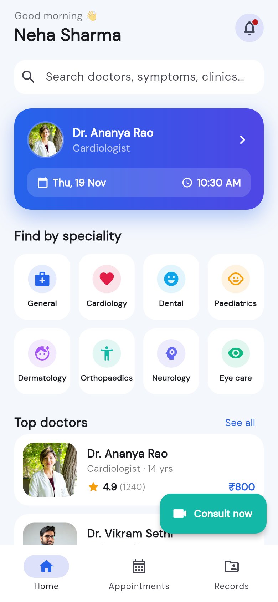
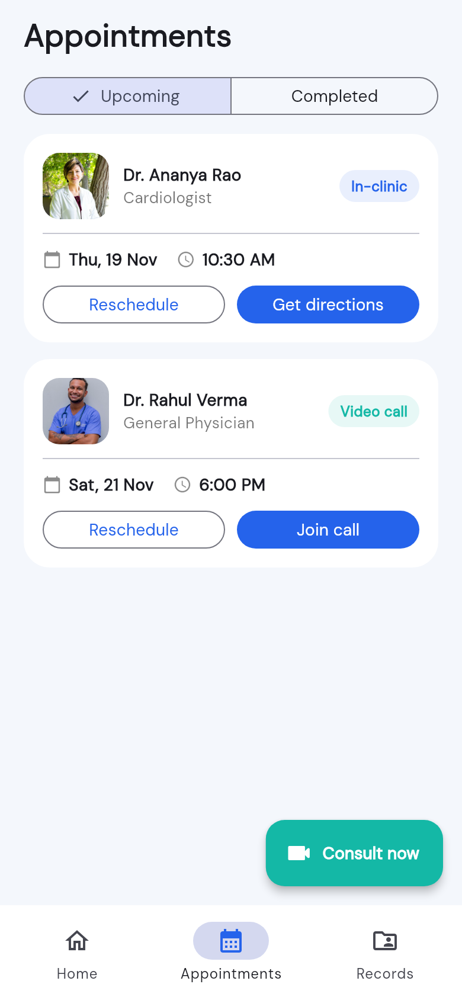
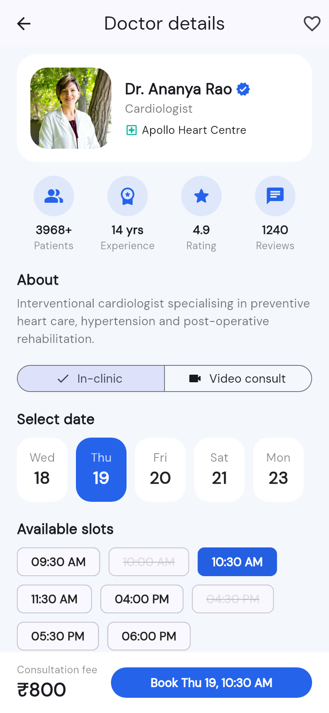

# Healthcare App Development | Custom Healthcare Software & Medical Applications

Build smarter healthcare experiences with **custom healthcare app development** by **Naya Prayog Technologies**.

We design and develop healthcare applications, medical software, and digital healthcare platforms that help hospitals, clinics, doctors, healthcare startups, and medical businesses improve patient engagement, streamline operations, and deliver accessible healthcare services.

From patient-facing mobile applications to hospital management systems and telemedicine platforms, we develop solutions around your business requirements.

**Looking for a Healthcare App Development Company?**  
Let's discuss your healthcare technology project.

- Website: https://nayaprayog.com/
- Email: support@nayaprayog.com
- Phone / WhatsApp: +91 7991327022
- Portfolio: https://github.helloharendra.io

---

<!-- screenshots -->
## Screenshots

<table>
  <tr>
    <td align="center"><b>Home</b>  </td>
    <td align="center"><b>Appointments</b>  </td>
    <td align="center"><b>Doctor Profile & Slot Booking</b>  </td>
  </tr>
</table>

---

## Healthcare App Development Services

Naya Prayog Technologies provides custom healthcare software and mobile application development services for organizations looking to modernize their healthcare operations.

Our solutions can be designed for Android, iOS, web applications, and integrated administrative platforms.

### 1. Healthcare Mobile App Development

Develop user-friendly healthcare mobile applications that connect patients, doctors, and healthcare service providers.

Potential capabilities include:

- Patient registration and authentication
- Patient profiles and medical information
- Doctor discovery and profiles
- Appointment scheduling
- Appointment reminders and notifications
- Medical history and reports
- Prescription management
- Secure communication workflows
- Health service information

### 2. Hospital Management Software

Develop centralized hospital management solutions to streamline administrative and operational workflows.

Potential modules include:

- Patient registration and management
- Doctor and staff management
- Appointment management
- OPD and IPD workflows
- Billing and payment records
- Medical records management
- Pharmacy and inventory workflows
- Laboratory management
- Reports and dashboards

### 3. Telemedicine App Development

Build digital healthcare platforms that enable patients to connect with healthcare professionals remotely.

Potential capabilities include:

- Online doctor consultations
- Video and audio consultation integration
- Appointment scheduling
- Patient-doctor communication
- Digital prescriptions
- Consultation history
- Payment integration
- Consultation notifications

Video consultation, medical communication, and patient-data workflows require appropriate security, infrastructure, and regulatory consideration.

### 4. Doctor Appointment Booking Applications

Create appointment booking platforms for individual doctors, clinics, hospitals, and healthcare networks.

Potential features:

- Doctor listings and profiles
- Specialization-based search
- Availability and time-slot management
- Online appointment booking
- Booking confirmation
- Cancellation and rescheduling
- Appointment reminders
- Patient appointment history

### 5. Electronic Medical Records (EMR) and Patient Management

Develop patient information management systems to organize healthcare records and support clinical workflows.

Potential capabilities include:

- Patient profiles
- Medical history
- Consultation records
- Diagnosis information
- Prescription records
- Laboratory reports
- Document management
- Role-based access

### 6. Pharmacy and Medicine Delivery Applications

Develop digital pharmacy and medicine ordering platforms for pharmacies and healthcare businesses.

Potential capabilities include:

- Medicine catalog management
- Product search and categories
- Prescription upload workflows
- Shopping cart and ordering
- Order tracking
- Inventory management
- Payment integration
- Delivery management
- Pharmacy administration dashboard

Prescription validation and medicine-sale workflows must follow applicable laws and regulations.

### 7. Healthcare Administration Dashboard

Build centralized web dashboards for healthcare organizations to manage their application operations.

Potential capabilities include:

- Patient management
- Doctor and staff management
- Appointment monitoring
- Service and department management
- Billing records
- User and role management
- Reports and analytics
- Application configuration

---

## Healthcare Applications We Can Build

| Application Type | Target Users |
|---|---|
| Hospital Management System | Hospitals and healthcare groups |
| Doctor Appointment App | Doctors and clinics |
| Telemedicine Application | Healthcare startups and providers |
| Patient Management Software | Hospitals and clinics |
| Medical Records System | Healthcare organizations |
| Online Pharmacy App | Pharmacies and medicine retailers |
| Diagnostic Lab Management | Pathology and diagnostic centers |
| Healthcare Marketplace | Healthcare service providers |
| Home Healthcare App | Home healthcare businesses |
| Healthcare CRM | Medical service businesses |

The final feature set and integrations are defined according to the project scope, operational requirements, and applicable regulations.

---

## Who Can Benefit?

Our healthcare software development services are suitable for:

- Hospitals and multi-specialty clinics
- Individual doctors and medical practitioners
- Diagnostic laboratories
- Pathology centers
- Pharmacies
- Healthcare startups
- Telemedicine businesses
- Home healthcare providers
- Medical service networks
- Healthcare entrepreneurs

---

## Why Choose Naya Prayog Technologies?

We focus on building practical software solutions that address real business and operational requirements.

**Custom-Built Solutions**  
Applications designed around your healthcare workflows rather than forcing your business into a generic system.

**Multi-Platform Development**  
Solutions can be developed for Android, iOS, and web platforms according to project requirements.

**Scalable Architecture**  
Architecture and infrastructure planned around expected users, data, integrations, and future expansion.

**Business-Focused Development**  
Features and workflows designed to improve operational efficiency and user experience.

**Integration Capabilities**  
Potential integrations include payment gateways, notifications, video consultation services, and third-party APIs.

**Ongoing Technical Support**  
Deployment, maintenance, enhancements, and technical support can be included in the agreed project scope.

---

## Technology and Development Capabilities

Depending on the requirements, our development stack may include:

- **Mobile Development:** Flutter, Android, iOS
- **Frontend Development:** React, Next.js, modern web technologies
- **Backend Development:** Node.js, REST APIs
- **Database:** Firebase, MySQL, PostgreSQL, MongoDB
- **Cloud and Deployment:** VPS, cloud infrastructure, server deployment
- **Integrations:** Payment gateways, notifications, video communication APIs, and third-party services

The actual technology stack is selected according to the project's requirements.

---

## Healthcare Data Security and Compliance

Healthcare applications may process sensitive personal and medical information. Security and compliance must therefore be considered from the beginning of the development process.

Depending on the application and applicable jurisdiction, the project may require:

- Secure authentication and authorization
- Role-based access control
- Encrypted data transmission
- Appropriate protection of stored information
- Secure API architecture
- Audit logs and access monitoring
- Backup and recovery planning
- Privacy controls and consent workflows
- Applicable healthcare data protection and regulatory requirements

Compliance requirements depend on the target market, application functionality, and data handled. They should be assessed and validated with qualified compliance professionals. No specific regulatory certification is implied by this repository.

---

## Our Healthcare App Development Process

1. **Requirement Analysis** – Understand your healthcare business, users, workflows, and objectives.
2. **Planning and Architecture** – Define modules, integrations, platforms, and technical architecture.
3. **UI/UX Design** – Create intuitive experiences for patients, doctors, and administrators.
4. **Application Development** – Develop the mobile apps, backend, APIs, and web dashboards.
5. **Testing and Quality Assurance** – Test functionality, performance, usability, and security controls.
6. **Deployment** – Prepare and deploy the agreed application components.
7. **Maintenance and Enhancement** – Support future improvements and expansion as agreed.

---

## Frequently Asked Questions

### What is healthcare app development?

Healthcare app development involves creating digital applications and software for hospitals, clinics, doctors, patients, pharmacies, and other healthcare businesses.

### Can you develop a custom hospital management system?

Yes. We can develop a hospital management solution with modules such as patient management, appointments, billing, staff management, medical records, and reporting according to your requirements.

### Can you build a healthcare app for Android and iOS?

Yes. We can develop cross-platform applications using Flutter or choose another suitable technology based on your project.

### Can you develop a telemedicine application?

Yes. Telemedicine solutions can include appointment booking, doctor-patient communication, video consultation integration, prescriptions, and consultation history, subject to the agreed scope.

### Can you integrate payment gateways and third-party APIs?

Yes. Payment gateways, notification services, video communication APIs, and other third-party services can be integrated where supported and appropriate.

### Do you develop healthcare software for startups?

Yes. We work on custom software and application development projects for startups, established businesses, and healthcare service providers.

### How much does healthcare app development cost?

The cost depends on application complexity, platforms, user roles, integrations, security requirements, and the number of modules. Contact us to discuss your requirements and receive a project estimate.

---

## Let's Build Your Healthcare Application

Have an idea for a healthcare mobile app, hospital management system, telemedicine platform, or medical software?

**Naya Prayog Technologies** can help turn your requirements into a practical digital solution.

**Start Your Project Discussion**

- Website: https://nayaprayog.com/
- Email: support@nayaprayog.com
- Call / WhatsApp: +91 7991327022
- Direct WhatsApp: https://wa.me/917991327022
- Portfolio: https://github.helloharendra.io

**Naya Prayog Technologies**  
Custom Software Development | Mobile App Development | Healthcare Technology | Business Automation

---

## Repository Information

This repository is a healthcare app development service and portfolio showcase by Naya Prayog Technologies. It is intended to describe our healthcare software development capabilities and project solutions.

It does not represent a claim that every feature listed above is already implemented in a publicly available application.

**Proprietary Notice:** This repository is a project showcase. No permission to redistribute, reuse, or commercially exploit proprietary source code, branding, or materials is granted unless separately authorized in writing.
